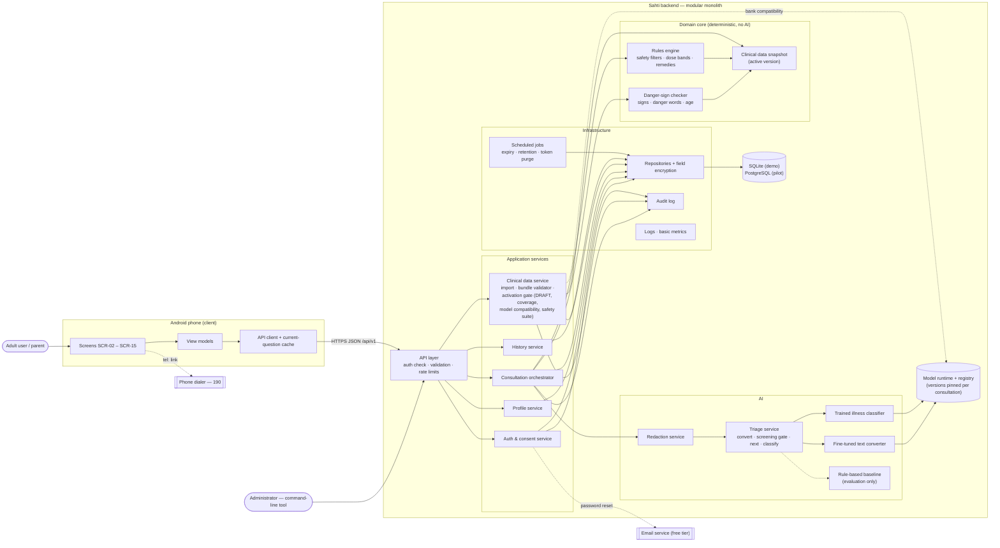
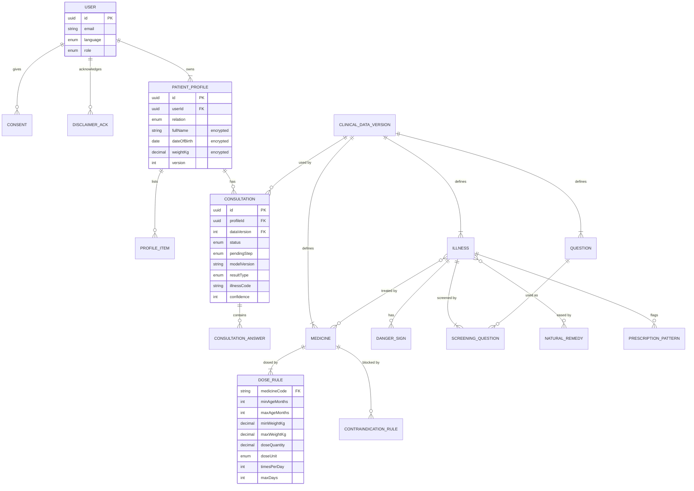
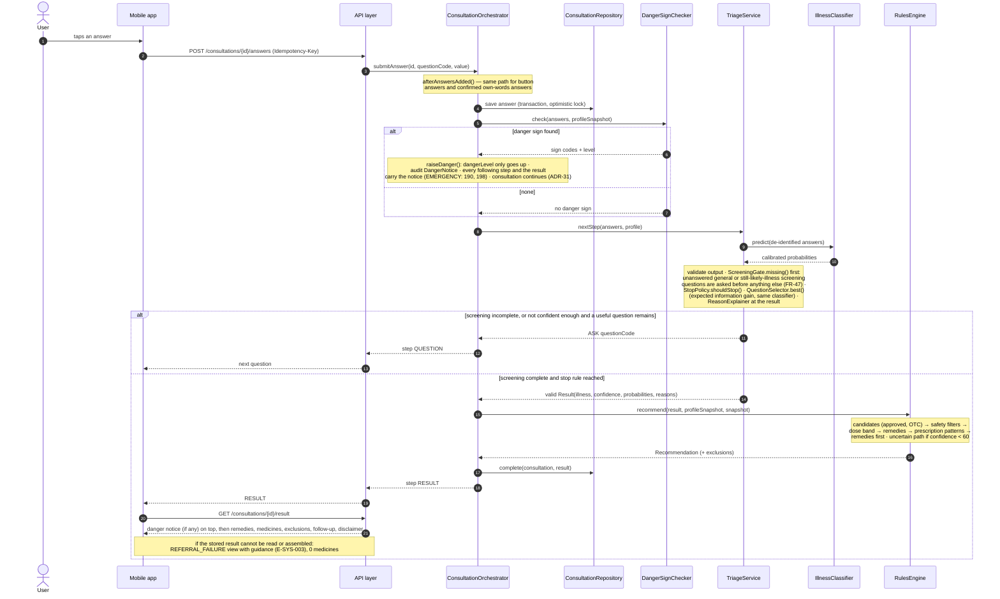
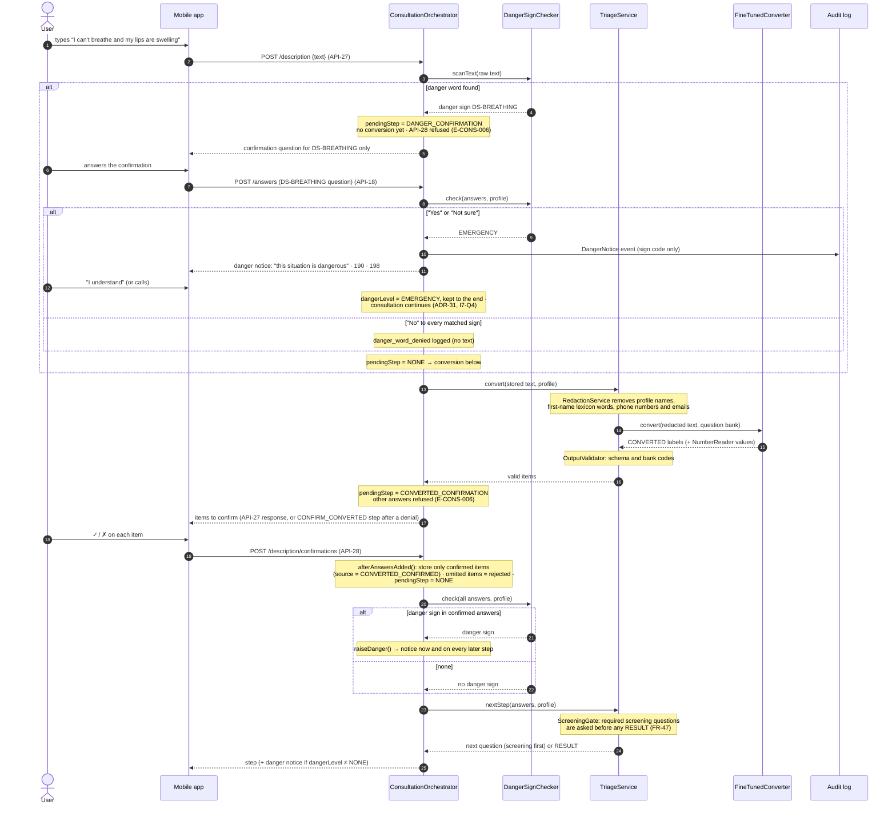

# Architecture

> Living summary of the Lab 4/5 design. The full design is [reference/SDD.md](reference/SDD.md) (v0.6) and the decisions are in [reference/decisions-and-quality-scenarios.md](reference/decisions-and-quality-scenarios.md). When code and this file disagree, fix one of them in the same PR.

## 1. Overview

Sahti is a **client–server** system: a Flutter Android app talks over HTTPS/JSON (`/api/v1`) to one Python **modular monolith** (FastAPI) with a relational database (SQLite for the course demo, PostgreSQL from the pilot). The backend has four layers:
1. an API layer;
2. application services (auth, profiles, consultation orchestrator, history, clinical data);
3. a **deterministic domain core** (danger-sign checker and rules engine, no AI);
4. an **AI module** (text reader + illness classifier), with infrastructure (repositories with field encryption, audit log, logs/metrics, scheduled jobs).

All medical content — illnesses, questions, danger signs, medicines, dose bands, rules, remedies — is **versioned data**, imported as a CSV bundle and activated only after the safety test suite passes.

## 2. Component diagram

## 3. Key modules

| Module (planned package) | Responsibility | Requirements | Lives in |
|---|---|---|---|
| API layer | Auth check, consent/disclaimer gates, schema validation, rate limits, error format | NFR-08, SEC-01 – SEC-09 | `backend/app/` (`main.py` today) |
| `auth` | Accounts (email + password), tokens, consent, disclaimer, deletion | FR-01 – FR-05 | `backend/app/auth/` |
| `profiles` | Patient profiles, encrypted health fields, uncertain child weight | FR-06 – FR-12, FR-44 | `backend/app/profiles/` |
| `consultation` | Orchestrator: every answer → store → danger check → next step; pending confirmations; undo | FR-13 – FR-23, FR-41 – FR-43, FR-47 | `backend/app/consultation/` |
| `danger_signs` | Deterministic danger signs, danger words, age rule; persistent notice | FR-14, FR-17, FR-18, FR-42, AI-09 | `backend/app/danger_signs/` |
| `triage` (AI) | Redaction, text reader, classifier, screening gate, stop rule, question selection, reasons | AI-01 – AI-20, FR-16, FR-21, FR-47 | `backend/app/triage/` |
| `rules_engine` | Safety filters, dose bands, remedies, uncertain path, prescription patterns, remedies first | FR-22, FR-24 – FR-34, FR-43, FR-45, FR-46 | `backend/app/rules_engine/` |
| `clinical_data` | Bundle import, validation, activation gate (DRAFT, coverage, model compatibility, safety suite) | FR-39, FR-40, NFR-15, NFR-16 | `backend/app/clinical_data/` |
| `history`, `audit`, `observability` | Past consultations; append-only audit; logs and metrics without personal data | FR-35 – FR-37, FR-40, NFR-09 | `backend/app/…` |
| Mobile app | Screens SCR-02 – SCR-15, RTL Arabic, current-question cache | FR-38, NFR-11 – NFR-14 | `mobile/` |

## 4. Data model

Full attributes in [SRS §8](reference/SRS.md). Overview:

## 5. Key flows

**Button answers → result (SD-01, UC-03).** Every answer goes through the same path: store, then danger check, then the next step. Danger questions come first (screening gate). A danger sign adds a notice that stays on every later screen.

**Own words (SD-02, UC-03/UC-04).** A matched danger word is confirmed **before** any conversion. Converted answers are used only after the user confirms them.

Other diagrams (classes, clinical data, data update, screen flow): PNG files in [`docs/diagrams/`](diagrams/) and Mermaid sources in [reference/SDD.md](reference/SDD.md).

## 6. The AI-assisted component

| Model | What goes in | What comes out | If it fails |
|---|---|---|---|
| **Text reader** — fine-tuned multilingual encoder (mmBERT-base vs XLM-R-base, bake-off) | Own-words text with names, phone numbers and emails removed; the question bank | One yes / no / not-mentioned label per bank question (precision ≥ 0.90); numbers read by fixed patterns | Timeout (3 s) or invalid output → fall back to button questions (E-AI-004) |
| **Illness classifier** — fast trained classifier (e.g. logistic regression / gradient boosting), calibrated | Age band, sex, pregnancy, language, confirmed answers (no identity data) | Probabilities over the 20 illnesses + out-of-scope, a confidence of 0–100, 2–4 reasons; next question by expected information gain | Timeout (2 s), exception or invalid output → `REFERRAL_FAILURE`, no medicines (NFR-17) |

Both models run in the backend on our own server; no text or health data goes to an external AI service. Neither model can produce a medicine, dose or remedy: the rules engine chooses those from validated data. Not built yet: the base model is chosen by the bake-off (OQ-07), and the training data doesn't exist yet.

## 7. Known trade-offs / open questions

- **No clinical data yet** (OQ-01 – OQ-05): the code can be built and tested with fixture data only; every bundle is DRAFT until a pharmacist validates it.
- **Danger sign does not stop the consultation** (design ADR-31, owner's decision `I7-Q4`): the notice persists, but medicines can be shown under it — risk RE R-17, to review with the clinical reviewer.
- **No measurements yet**: latency and model size figures are estimates until the bake-off (AR-1, AR-2).
- **SQLite → PostgreSQL** later: no database-specific SQL allowed until then.
- **Flutter project** not generated yet; CI runs backend tests only.
