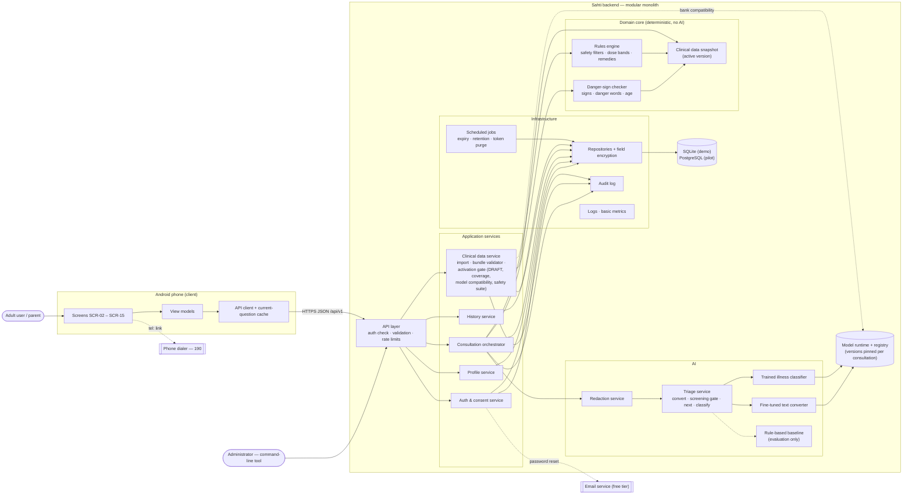
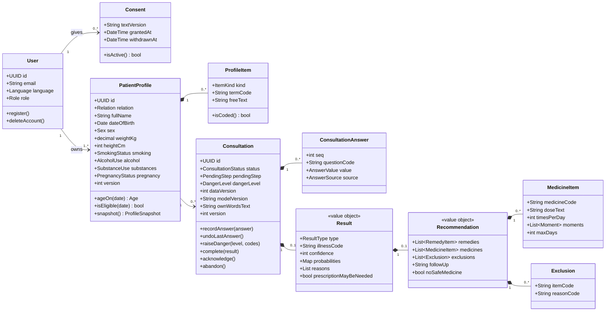
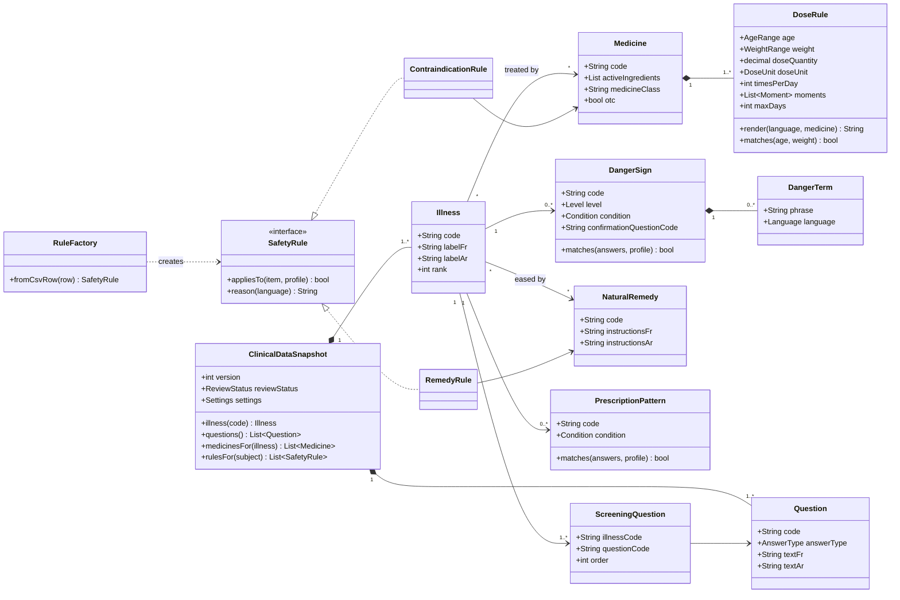
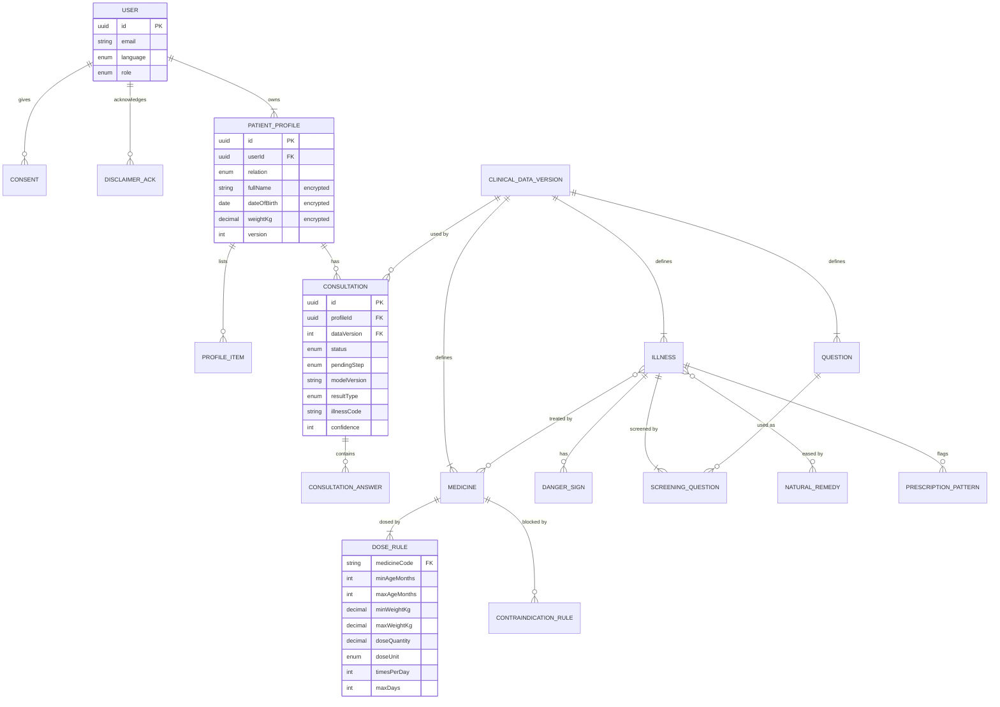
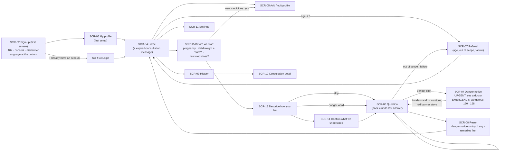
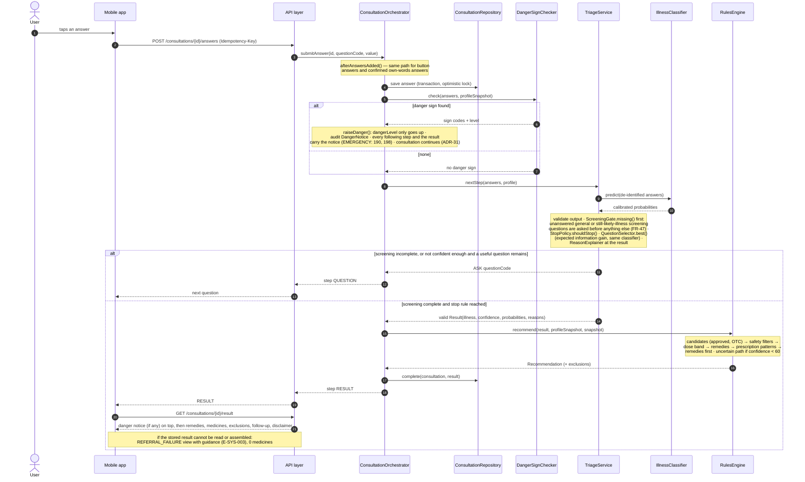
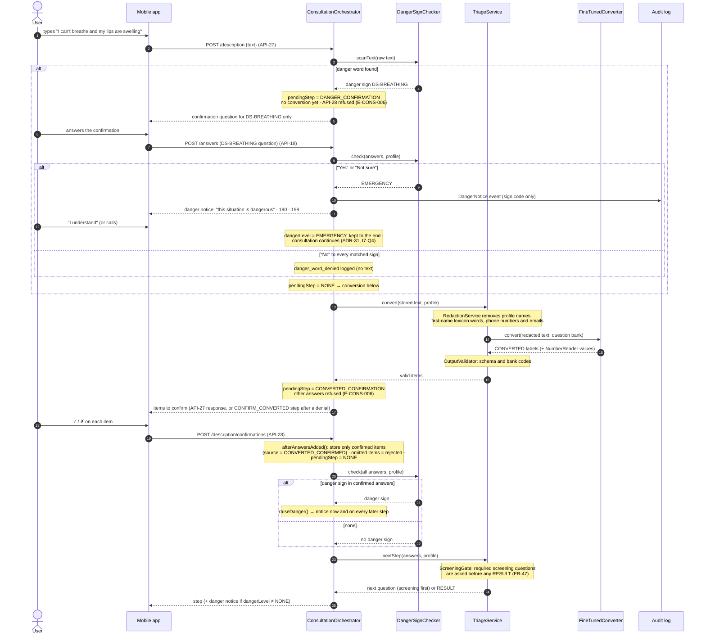
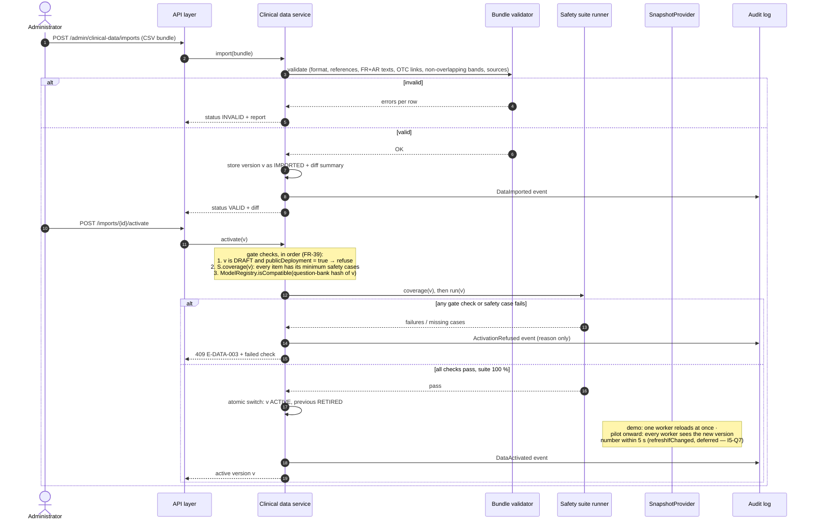

# SDD — Software Design Document

**Project:** Sahti (صحتك) · **Version:** 0.6 · **Date:** 2026-11-03
**Author:** Abubaker (product owner, sole developer), with Claude as AI software architect
**Labs:** Lab 4 *Design and Methodology* (IEEE 1016-style SDD) and Lab 5 *Designing Your Own Project's Architecture* — applied to Sahti.
**Inputs:** [[SRS — Software Requirements and System Specification]] v0.4 · [[RE — Requirements Elicitation Document]] v0.4

> **Decisions and quality scenarios:** [[SDD — Architecture Decisions and Quality Scenarios]] (ADRs, six-part QAS, trade-offs, complexity bill).
>
> **v0.6 (2026-11-03):** product owner's own review RV-27 – RV-35 (LOG round 7): danger sign → persistent notice and the consultation continues (ADR-31, `I7-Q4`); uncertain child weight → lower band; 190 + 198; language on the sign-up screen; SCR-15 "Before we start"; undo of the last answer (ADR-32, API-29); expiry message on Home. SD-01, SD-02 and the screen flow redrawn.
>
> **v0.5 (2026-11-03):** fixes from the independent design-phase evaluation [[SDD — Evaluation Run 1]] (EV1, `I6-Q0`): `ScreeningGate` (FR-47) in SD-01/SD-02; pending-confirmation state for own words (SD-02); activation gate with `BundleValidator`, `SafetySuiteRunner` and `ModelRegistry` (SD-03); `ResultAssembler.failureView()`; structured dose; design traceability completed for NFR, AI and BR; review log RV-18 – RV-26.
>
> **v0.4 (2026-11-03):** consistency-audit answers applied ([[SDD — Consistency Audit 1]], LOG round 5): text reader as a classifier with a deterministic number reader; SQLite for the demo, PostgreSQL from the pilot; command-line admin; tracing removed; multi-worker support deferred to the pilot; per-illness age/sex limits (FR-46). Photo feature: questions only in v1, photos as future F-06 (`I5-Q8`). · v0.3: fine-tuned model reads text only, trained classifier decides (ADR-03/04), own server (ADR-05), Flutter (ADR-10).
>
> Every design element below traces to a requirement ID (FR / NFR / AI / BR). Diagrams are written in Mermaid (Obsidian renders them); PNG exports for the submission are in `Sahti/Design/`.

---

## 1. Introduction

### 1.1 Purpose
This document describes **how** Sahti will be built to satisfy the SRS: architecture, components, classes, data, interfaces, behaviour and the reasons behind each choice. It is the bridge between the specification and the code, and the reference for AI-assisted implementation.

### 1.2 Scope
Version 1 of the Sahti Android app and its backend: accounts and consent, patient profiles, consultation (own words + button questions until confident), danger-sign referral, classification among 20 common illnesses by a fine-tuned model, deterministic selection of natural remedies and OTC medicines with exact doses, history, French and Modern Standard Arabic, and clinical-data administration. Out of scope as in SRS §2.2.

### 1.3 Definitions, acronyms, abbreviations
As in SRS §1.4, plus:

| Term | Meaning |
|---|---|
| Modular monolith | One deployable backend split into modules with strict boundaries |
| Domain core | The deterministic modules that make safety decisions: danger-sign checker, rules engine, clinical data snapshot |
| Snapshot | An immutable, in-memory copy of the active clinical data version |
| Safety filter | One class that removes unsafe candidates for one rule type (allergy, condition, …) |
| MVVM | Model–View–ViewModel, the mobile app's presentation pattern |

### 1.4 References
SRS v0.4 (requirements, data and API specification) · RE v0.4 · [[RE — Interview Log]] · Lab 4 and Lab 5 documents · IEEE 1016 (SDD structure) · ISO/IEC/IEEE 29148.

---

## 2. System Architecture

### 2.1 Chosen methodology and architectural style

**Methodology: Object-Oriented Design. Architecture: client–server, with a layered modular-monolith backend and a deterministic domain core isolated from the AI.**

| Option considered | Fits Sahti? | Reason for choice / rejection |
|---|---|---|
| Structured design (top-down functional) | No | The domain has rich entities with behaviour (profiles, consultations, rules, dose bands); functions alone would scatter safety logic. |
| **Object-oriented design** | **Yes** | Clear entities (PatientProfile, Consultation, Medicine, DoseRule, SafetyRule) and behaviour (`matches`, `appliesTo`, `recommend`); interfaces let the AI be swapped and tested (AI-06). |
| Component-based design | Partly | Used inside the backend as *modules*, not as separately deployed components. |
| **Client–server** | **Yes** | Profiles and history must be stored server-side (FR-35); the phone works on weak internet (NFR-01 – NFR-03). |
| **Layered (n-tier)** | **Yes, inside the backend** | API → application services → domain core → infrastructure; each layer testable on its own (NFR-16). |
| MVC | In the app, as MVVM | Fits interactive screens; MVVM suits declarative UI frameworks. |
| Microservices | No | Solo developer, zero budget (C-01, C-04): separate deployments, networks and monitoring would cost time and money without a benefit at 100 concurrent users (NFR-05). |
| Event-driven | No (as main style) | The consultation is a synchronous question–answer flow. Only internal domain events are used, for audit and metrics (§7.1). |

**Justification.** Sahti's core is a safety decision on rich domain data, so object-oriented design gives each rule and entity one clear responsibility and lets every rule type be unit-tested in isolation, which the 100 % safety-suite gate requires (NFR-16). A client–server split is forced by stored profiles and history; inside the server, a layered modular monolith is the simplest structure a single developer can build, host for free and defend in front of a jury. The key architectural decision is the **separation between the AI module and the deterministic domain core**: the AI may only propose answers and probabilities, while the danger-sign checker and the rules engine — which never call the AI — decide what the user sees (AI-03, AI-09, BR-06). Microservices were rejected because their operational cost contradicts the zero-budget and solo constraints without a scalability need.

### 2.2 Component diagram

### 2.3 Component responsibility descriptions

| Component | Responsibility | Talks to | Requirements |
|---|---|---|---|
| Screens (SCR-02 – SCR-15; SCR-01 merged into SCR-02, SCR-12 removed) | Display, input, RTL layout, accessibility | View models | FR-38, NFR-13, NFR-14 |
| View models | Screen state, client-side validation, navigation | API client | NFR-12 |
| API client + cache | HTTPS calls, retries with idempotency keys, caching the current question | API layer | FR-23, NFR-01 – NFR-03 |
| API layer | Authentication, consent/disclaimer gates, schema validation, rate limits, error format | Application services | NFR-08, SEC-01 – SEC-09 |
| Auth & consent service | Accounts, tokens, consent, disclaimer acknowledgement, deletion | Repositories, audit, email | FR-01 – FR-05 |
| Profile service | Profiles, items, field encryption, eligibility | Repositories | FR-06 – FR-12, FR-44 |
| Consultation orchestrator | Runs one consultation step by step; owns status and `pendingStep` transitions (danger confirmation before conversion; converted answers confirmed before anything else) | Danger checker, triage service, rules engine, repositories | FR-13 – FR-23, FR-41 – FR-43, FR-47 |
| History service | Lists and returns stored consultations | Repositories | FR-35 – FR-37 |
| Clinical data service | Import; activation gate: DRAFT refused in a public deployment, safety-case coverage, question-bank compatibility with the deployed models, safety suite 100 %; atomic activation; audit | Bundle validator, safety suite runner, model registry, repositories, snapshot provider, audit | FR-39, FR-40, NFR-15, NFR-16, NFR-23 |
| Bundle validator | Checks a CSV bundle against SRS §8.5 and §8.7 rules 1–11 | — | FR-39, NFR-19 |
| Safety suite runner | Checks that every clinical item has its minimum safety cases, then runs TC-SAFE-* against a data version with the AI stubbed | Snapshot provider, orchestrator (test mode) | NFR-16, FR-39 |
| Danger-sign checker | Deterministic danger signs, danger words, age rule; returns the danger level that the orchestrator keeps as a persistent notice (ADR-31) | Snapshot | FR-14, FR-17, FR-18, FR-42, AI-09 |
| Rules engine | Safety filters, dose bands, remedies, uncertain path, prescription patterns, ordering | Snapshot | FR-22, FR-24 – FR-34, FR-43, FR-45 |
| Clinical data snapshot | Read-only clinical data of one version in memory; recent versions cached so open consultations keep theirs | — | PD-07, PD-16, FR-39 |
| Redaction service | Removes profile names, first-name lexicon words (`I6-Q4`), phone numbers and emails from own-words text (best effort) | Snapshot (name lexicon) | AI-16 |
| Triage service | Redacts text; calls the fine-tuned **text converter** (own words only) and the trained **illness classifier** (once per step); validates outputs; **asks required screening questions first and never classifies before they are answered** (FR-47); applies the stop rule; selects the next question and explains reasons with the same classifier | Text converter, classifier | AI-01, AI-07, AI-08, AI-10, FR-16, FR-21, FR-47 |
| Rule-based baseline | Same interface as the model, for evaluation (AI-06) | — | AI-06 |
| Repositories + field encryption | Persistence through one data-access layer; AES-256-GCM on P3 fields; SQLite for the demo, PostgreSQL from the pilot (`I5-Q3`) | Database | NFR-07, NFR-18 |
| Audit log | Append-only events; `actorHash` keyed per user so it is unlinked when the account is deleted (`I6-Q5`) | Repositories (same database: SQLite for the demo, PostgreSQL from the pilot) | FR-40, SEC-14 |
| Logs · basic metrics | Observability without personal data; no distributed tracing in v1 (`I5-Q7`) | — | NFR-09, AI-13 |
| Scheduled jobs | Expire consultations after 24 h; delete abandoned ones after 30 days; purge expired refresh tokens; log retention | Repositories | FR-23, SRS §8.6 |
| Model runtime + model registry | Serves the fine-tuned text converter and the trained classifier on the project's own server (local for the course demo) (ADR-05); keeps the model versions a consultation started with until no open consultation uses them; records the question-bank hash each version was trained on (`I6-Q6`, ADR-23) | — | AI-19, NFR-24, FR-39 |

### 2.4 Deployment view (course demo)
One laptop runs **one** backend worker process, an SQLite database file and the model runtime. From the pilot onward, several workers and PostgreSQL are used, and each worker checks the active clinical data version in the database (cached ≤ 5 s [Proposed]) so all workers switch together (DR-04 — deferred to the pilot, `I5-Q7`); the app runs on an Android phone or emulator on the same network. The model must be small and quantised to fit the ~6 GB of free disk (C-08); training happens on a free cloud GPU and only the trained weights are copied locally (SRS SR-04). While an older model version is kept for open consultations (≤ 24 h, FR-23), two text-reader versions can be on disk at once — about 1.2 GB for an encoder of mmBERT-base size [ESTIMATE: 2 × ~0.6 GB, Model Selection §4], within the 2 GB model budget (ADR AR-2). Free-tier hosting is decided later (OQ-08).

---

## 3. Detailed Design

### 3.1 Class diagrams

**(a) Domain model — patient and consultation**

**(b) Consultation services, AI and rules engine**

```mermaid
classDiagram
  direction TB
  class ConsultationOrchestrator {
    +start(profileId, pregnancyReconfirmed) Step
    +submitDescription(id, text) DescriptionStep
    +confirmConverted(id, items) Step
    +submitAnswer(id, questionCode, value) Step
    +undoLastAnswer(id) Step
    -afterAnswersAdded(consultation) Step
  }
  class DangerSignChecker {
    +check(answers, profile) List~DangerSign~
    +scanText(text) List~DangerSign~
  }
  class TriageService {
    +convert(text, profile) Conversion
    +nextStep(answers, profile) Step
  }
  class ScreeningGate {
    +missing(answers, stillLikely, snapshot) List~QuestionCode~
  }
  class ModelRegistry {
    +get(modelVersion) ModelPair
    +isCompatible(bankHash) bool
    +retireWhenUnused(modelVersion)
  }
  class TextConverter {
    <<interface>>
    +convert(redactedText, bank) Labels
  }
  class FineTunedConverter {
    -ModelRegistry registry
    -Map thresholds
    +convert(redactedText, bank) Labels
  }
  class IllnessClassifier {
    <<interface>>
    +predict(answers, context) Probabilities
  }
  class TrainedClassifier {
    -Calibrator calibrator
    +predict(answers, context) Probabilities
  }
  class RuleBasedBaseline {
    +predict(answers, context) Probabilities
  }
  class StopPolicy {
    <<interface>>
    +shouldStop(probabilities, candidates) bool
  }
  class ConfidenceStopPolicy {
    -int stopTarget
    -float epsilon
    +shouldStop(probabilities, candidates) bool
  }
  class QuestionSelector {
    +best(answers, allowedQuestions) Question
  }
  class NumberReader {
    +read(text, numericQuestions) List~Answer~
  }
  class ReasonExplainer {
    +reasons(answers, topIllness) List~QuestionCode~
  }
  class Calibrator {
    -float temperature
    +calibrate(scores) Probabilities
  }
  class OutputValidator {
    +validate(output, snapshot) Result
  }
  class RedactionService {
    +redact(text, knownNames) String
  }
  class RulesEngine {
    -List~SafetyFilter~ filters
    +recommend(result, profile, snapshot) Recommendation
    +uncheckedItems(profile) List~ProfileItem~
  }
  class SafetyFilter {
    <<interface>>
    +apply(candidates, context) FilterOutcome
  }
  class AllergyFilter
  class ConditionFilter
  class InteractionFilter
  class PregnancyFilter
  class SubstanceFilter
  class DuplicateFilter
  class DoseBandResolver {
    +resolve(medicine, age, weight) DoseRule
  }
  class UncertainPathSelector {
    +stillLikely(probabilities) Set~Illness~
  }
  class ResultAssembler {
    +assemble(result, recommendation) ResultView
    +failureView(language) ResultView
  }
  class ClinicalDataService {
    +importBundle(files) ImportReport
    +activate(version) ActivationResult
  }
  class BundleValidator {
    +validate(bundle) List~RowError~
  }
  class SafetySuiteRunner {
    +coverage(version) List~MissingCase~
    +run(version) SuiteReport
  }
  class SnapshotProvider {
    +get(version) ClinicalDataSnapshot
    +activeVersion() int
    +refreshIfChanged()
  }
  class ConsultationRepository {
    <<interface>>
    +get(id) Consultation
    +save(consultation)
  }
  ConsultationOrchestrator --> DangerSignChecker
  ConsultationOrchestrator --> TriageService
  ConsultationOrchestrator --> RulesEngine
  ConsultationOrchestrator --> ResultAssembler
  ConsultationOrchestrator --> ConsultationRepository
  ConsultationOrchestrator --> SnapshotProvider
  TriageService --> RedactionService
  TriageService --> TextConverter
  TriageService --> IllnessClassifier
  TriageService --> OutputValidator
  TriageService --> StopPolicy
  TriageService --> QuestionSelector
  TriageService --> ReasonExplainer
  TriageService --> NumberReader
  TriageService --> ScreeningGate
  FineTunedConverter --> ModelRegistry
  TrainedClassifier --> ModelRegistry
  ClinicalDataService --> BundleValidator
  ClinicalDataService --> SafetySuiteRunner
  ClinicalDataService --> ModelRegistry
  ClinicalDataService --> SnapshotProvider
  QuestionSelector --> IllnessClassifier
  ReasonExplainer --> IllnessClassifier
  TrainedClassifier --> Calibrator
  TextConverter <|.. FineTunedConverter
  IllnessClassifier <|.. TrainedClassifier
  IllnessClassifier <|.. RuleBasedBaseline
  StopPolicy <|.. ConfidenceStopPolicy
  RulesEngine o-- SafetyFilter
  RulesEngine --> DoseBandResolver
  RulesEngine --> UncertainPathSelector
  SafetyFilter <|.. AllergyFilter
  SafetyFilter <|.. ConditionFilter
  SafetyFilter <|.. InteractionFilter
  SafetyFilter <|.. PregnancyFilter
  SafetyFilter <|.. SubstanceFilter
  SafetyFilter <|.. DuplicateFilter
```

**(c) Clinical data model (read-only at runtime)**

### 3.2 Class descriptions

| Class | Attributes | Operations | Related classes | Responsibility (single reason to change) |
|---|---|---|---|---|
| User | id, email, language, role | register(), deleteAccount() | Consent, PatientProfile | Identity of one adult account |
| Consent | textVersion, grantedAt, withdrawnAt | isActive() | User | Legal basis for storing health data (FR-03) |
| PatientProfile | relation, fullName, dateOfBirth, sex, weightKg, heightCm, smoking, alcohol, substances, pregnancy, version | ageOn(), isEligible(), snapshot() | ProfileItem, Consultation | Health facts of one person |
| ProfileItem | kind, termCode, freeText | isCoded() | PatientProfile | One allergy / condition / medicine entry |
| Consultation | status, pendingStep, dangerLevel (only raised), dangerSignCodes, dataVersion, modelVersion (pinned), ownWordsText, version (optimistic lock), expiryNotified | recordAnswer(), undoLastAnswer(), raiseDanger(), complete(), acknowledge(), abandon() | ConsultationAnswer, Result | Lifecycle of one consultation, incl. the own-words sub-state `pendingStep` (State pattern, §7.1) |
| ConsultationAnswer | seq, questionCode, value, source | — | Consultation | One confirmed answer |
| Result | type, illnessCode, confidence, probabilities, reasons, prescriptionMayBeNeeded | — | Recommendation | Immutable outcome of classification |
| Recommendation | remedies, medicines, exclusions, followUp, noSafeMedicine | — | MedicineItem, Exclusion | Immutable output of the rules engine |
| ConsultationOrchestrator | (injected services) | start(profileId, pregnancyReconfirmed), submitDescription(), confirmConverted(), submitAnswer(), undoLastAnswer(), private afterAnswersAdded() | DangerSignChecker, TriageService, RulesEngine, ResultAssembler, ConsultationRepository, SnapshotProvider | Order of steps in a consultation — and nothing else. **Invariants:** every path that adds answers goes through `afterAnswersAdded()` = store → danger check → next step (DR-01); while `pendingStep ≠ NONE` only the pending step is accepted (E-CONS-006), and a danger word is confirmed before any conversion (EV1 F-02) |
| DangerSignChecker | — | check(), scanText() | ClinicalDataSnapshot | Deterministic danger detection |
| TriageService | — | convert(), nextStep() | RedactionService, TextConverter, IllnessClassifier, OutputValidator, ScreeningGate, StopPolicy, QuestionSelector, ReasonExplainer | All AI-related steps behind one door |
| ScreeningGate | — | missing() | ClinicalDataSnapshot, UncertainPathSelector | Required screening questions (general + every still-likely illness) not yet answered; `nextStep()` asks these first and never returns RESULT while any is missing (FR-47, EV1 F-01) |
| ModelRegistry | loaded versions, bank hash per version | get(), isCompatible(), retireWhenUnused() | FineTunedConverter, TrainedClassifier | Pins model versions per consultation (`I6-Q6`); refuses an incompatible question bank (EV1 F-07) |
| TextConverter (interface) / FineTunedConverter | registry, per-question thresholds | convert() | ModelRegistry | Fine-tuned multilingual encoder: one yes / no / not-mentioned decision per bank question (AI-19, AI-20) |
| NumberReader | — | read() | — | Deterministic extraction of durations and temperatures from text, for the user to confirm (FR-41) |
| IllnessClassifier (interface) / TrainedClassifier | calibrator | predict() | Calibrator | Decides the illness probabilities from confirmed answers — a trained, fast classifier (ADR-04) |
| Calibrator | temperature | calibrate() | TrainedClassifier | Calibrated confidence (AI-07); parameter versioned with the classifier (DR-08) |
| StopPolicy / ConfidenceStopPolicy | stopTarget, epsilon | shouldStop() | TriageService | "Ask until confident enough" (FR-16); consulted only after `ScreeningGate` reports nothing missing |
| QuestionSelector | — | best() | IllnessClassifier | Expected-information-gain choice (deterministic) using the same classifier that decides (ADR-03) |
| ReasonExplainer | — | reasons() | IllnessClassifier | Answers whose removal lowers the top illness most, computed with the deciding classifier, so reasons are faithful (FR-21, C-2 resolved) |
| OutputValidator | — | validate() | ClinicalDataSnapshot | Schema and code checks on AI output (AI-08) |
| RedactionService | — | redact() | ClinicalDataSnapshot (name lexicon) | Privacy before the AI (AI-16), best effort |
| ResultAssembler | — | assemble(), failureView() | Result, Recommendation | Builds the result view (remedies first, FR-45); returns the failure guidance view if a stored result cannot be read (E-SYS-003, NFR-17, EV1 F-08) |
| RulesEngine | filters | recommend(), uncheckedItems() | SafetyFilter, DoseBandResolver, UncertainPathSelector | Order of the recommendation pipeline; reports uncoded profile items (FR-11, DR-10) |
| SafetyFilter (interface) + 6 filters | — | apply() | SafetyRule | One rule family each |
| DoseBandResolver | uncertainWeightMarginKg | resolve() | DoseRule | Exact band lookup (PD-12); for a child whose weight is marked "not sure", looks up weight − 3 kg so the lower band is used (`I7-Q1`) |
| UncertainPathSelector | — | stillLikely() | — | Still-likely set (PD-18) |
| ClinicalDataSnapshot | version, reviewStatus, settings | illness(), questions(), medicinesFor(), rulesFor() | all clinical classes | Read-only view of one data version (incl. per-illness age/sex limits, FR-46) |
| SafetyRule (interface), ContraindicationRule, RemedyRule | target, reason texts, source | appliesTo(), reason() | Medicine, NaturalRemedy | One validated safety rule |
| DoseRule | age range, weight range, doseQuantity, doseUnit, timesPerDay, moments, maxDays | matches(), render(language) | Medicine | One validated dose band; FR and AR dose text rendered from the same numbers (EV1 F-04, `I6-Q3`) |
| DangerSign, DangerTerm, PrescriptionPattern | condition, level, confirmationQuestionCode, phrase | matches() | Illness | Validated triggers (DR-13) |
| RuleFactory | — | fromCsvRow() | SafetyRule | Builds rule objects from imported rows |
| ScreeningQuestion | illnessCode (or ALL), questionCode, order | — | Illness, Question | One required screening question (FR-47) |
| ClinicalDataService | — | importBundle(), activate() | BundleValidator, SafetySuiteRunner, ModelRegistry, SnapshotProvider | Import and the activation gate (FR-39) |
| BundleValidator | — | validate() | RuleFactory | Bundle rules of SRS §8.7 |
| SafetySuiteRunner | — | coverage(), run() | SnapshotProvider | Release gate (NFR-16) with coverage check (EV1 F-07) |

---

## 4. Data Design

### 4.1 Data model / database schema
Full attribute list: SRS §8.1. Entity–relationship overview:

Design decisions:
- **Health fields encrypted per field** in the repository layer (AES-256-GCM), so domain classes see plain values and the database never does (NFR-07).
- **Clinical data is versioned and immutable**; each consultation stores its `dataVersion`, `modelVersion` and a `profileSnapshot`, so a past result can always be explained (FR-37).
- **Illnesses are rows, not code** (PD-16): adding illness 21 is a data import, including its screening questions (FR-47).
- **Doses are numbers, not text** (`I6-Q3`, EV1 F-04): a band stores `doseQuantity` and `doseUnit`; the FR and AR sentences are rendered from them, so the two languages cannot state different amounts.

### 4.2 Key data structures
| Structure | Where | Why |
|---|---|---|
| `ProfileSnapshot` (immutable) | Passed to danger checker, rules engine and AI request builder | The same facts are used for the whole consultation, even if the profile is edited meanwhile |
| `ClinicalDataSnapshot` (immutable, in memory) | SnapshotProvider, keyed by version | Fast rule evaluation; atomic switch on activation; open consultations keep their version (DR-03) |
| `Probabilities` (map illness → p, sums to 1) | TriageService | Feeds the stop rule, question selection and the uncertain path |
| `FilterOutcome` (kept candidates + exclusions with reasons) | RulesEngine | Every exclusion keeps its reason for FR-34 |
| `TriageRequest` (de-identified) | TriageService → model | Only AI-02 fields (SRS §10.3) |

---

## 5. Interface Design

### 5.1 User interface overview
Screens are specified in SRS §13. Navigation:

UI design rules applied everywhere: one decision per screen; large buttons; Arabic fully right-to-left; doses always in digits 0–9; remedies above medicines (FR-45); red referral screens that cannot be skipped (FR-14, FR-19, FR-46); a danger notice (FR-18) that stays as a red banner on every later screen and on the result, with 190 and 198 for emergencies (ADR-31).

### 5.2 API / integration points
- **Public API:** 29 REST endpoints, SRS §9 (API-01 – API-29).
- **Internal AI contracts:** `TextConverter.convert()` (fine-tuned model) and `IllnessClassifier.predict()` (trained classifier; the rule-based baseline implements the same interface), with the de-identified request of SRS §10.3. Both the fine-tuned model and the baseline implement it.
- **Clinical data import:** CSV bundle, SRS §8.7.
- **External:** phone dialer (`tel:190`), free email service for password reset (OQ-13), model runtime (local).

---

## 6. Behavioural Design

### 6.1 SD-01 — UC-03 Run a consultation (button answers, normal result)
Traces to: UC-03, FR-15 – FR-17, FR-20 – FR-22, FR-24 – FR-34, FR-45, FR-47, NFR-17.

### 6.2 SD-02 — UC-03 own words, with UC-04 danger notice
Traces to: UC-03, UC-04, FR-17, FR-18, FR-41, FR-42, FR-47, AI-16. (Simplification: the API layer between app and orchestrator is not drawn.) A danger word is confirmed **before** the text is converted, and nothing else is accepted while a confirmation is pending (EV1 F-02).

### 6.3 SD-03 — UC-06 Update clinical data
Traces to: UC-06, FR-39, FR-40, NFR-15, NFR-16, NFR-23.

Design choices visible here: **activation runs four gate checks automatically** — DRAFT in a public deployment, safety-case coverage, question-bank compatibility with the deployed models, and the safety suite — and refuses a version that fails any of them (EV1 F-04, F-07), so the release gate of NFR-16 cannot be forgotten; the audit entry is written **in the same transaction** as the activation (DR-05).

---

## 7. Design Rationale

### 7.1 Design patterns used and why

| Pattern | Problem solved | Where applied | Justification |
|---|---|---|---|
| **Strategy** | The AI must be swappable and comparable with a baseline (AI-06); the stop rule must be tunable | `IllnessClassifier` (TrainedClassifier, RuleBasedBaseline) and `TextConverter` (FineTunedConverter); `StopPolicy` | The orchestrator never changes when the model changes; the evaluation runs the same pipeline with each strategy. |
| **Chain of Responsibility / pipeline** | Many independent safety checks in a fixed order (FR-24 – FR-34) | `RulesEngine` with ordered `SafetyFilter`s | Each rule family is one small class with its own tests; a new family (e.g. SUBSTANCE, FR-44) is a new filter, without editing the others (open/closed). |
| **Adapter** | The model runtime's API should not leak into the domain | `FineTunedConverter` wraps the runtime | Changing the inference library or hosting touches one class. |
| **Repository** | Persistence with encryption, testable without a database | `ConsultationRepository` and siblings | Domain code works on objects; tests use in-memory repositories. |
| **State** | Consultation status must follow legal transitions only | `Consultation` (IN_PROGRESS → AWAITING_ACK → COMPLETED, or ABANDONED; sub-state `pendingStep` NONE / DANGER_CONFIRMATION / CONVERTED_CONFIRMATION) | Illegal actions (answering a finished consultation, skipping a pending confirmation) are rejected in one place (E-CONS-005, E-CONS-006). |
| **Factory Method** | Rule objects of many target types built from CSV rows | `RuleFactory.fromCsvRow()` | Import code does not know every rule class. |
| **Observer (domain events)** | Audit and metrics must not clutter business code | Events `DangerNotice`, `ConsultationCompleted`, `DataImported`, `DataActivated` → audit log, metrics | Business classes publish; subscribers react (SEC-14). **Audit subscribers run synchronously in the publisher's transaction** so an audit failure rolls the action back (FR-40); only metrics are asynchronous (DR-05). |
| **Facade** | The orchestrator was depending on five AI-related classes | `TriageService` | Reduces coupling (review issue RV-02). |

### 7.2 Alternatives considered and trade-offs

| Decision | Alternative | Why not |
|---|---|---|
| Modular monolith | Microservices | Ops cost, zero budget, solo developer; no scale need |
| Model on the server | Model on the phone | Phones of the target users are modest; the model and its updates would make the app heavy; a server keeps one model version for everyone. Cost: needs internet (accepted: no offline mode, C-05) |
| Fine-tuned model proposes, rules decide | Model decides medicines | Safety, legality, testability (AI-03, BR-06, BR-16) |
| Deterministic question selection over model probabilities | Model generates the next question | Questions stay reviewed in both languages; stop rule is measurable (FR-16) |
| Injected `SnapshotProvider` | Singleton for the active clinical data | A singleton hides a global dependency and makes tests share state; injection keeps tests isolated (review issue RV-03) |
| Trained classifier for deciding and choosing questions; fine-tuned model only for reading text (ADR-03, ADR-04) | Fine-tuned model for every expected-gain calculation | ~300 predictions per step would break the 0.8 s server budget (NFR-02a) (DR-02, decision D-1) |
| Optimistic locking on Consultation | Database row locks for the whole step | Simple; a stale second device gets 409 instead of corrupting the order (DR-12) |
| Danger detection outside the AI | AI flags danger | The AI can miss; fixed rules cannot be talked out of a danger sign (AI-09, FR-42) |
| Mandatory screening gate before any result (FR-47) | Let expected-gain selection decide whether danger questions are asked | EV1 F-01: confident own-words answers could reach a result before any danger question |
| Danger confirmation before conversion (pending state) | Return confirmations and converted answers together | EV1 F-02: a client could confirm the converted answers and skip the danger confirmation |
| Flutter (ADR-10, decided 2026-11-03) | Native Kotlin; React Native; web app | Keeps iPhone possible later (F-04) with one code base; RTL support built in |
| Field-level encryption | Whole-disk encryption only | Protects data even from someone reading the database directly |

### 7.3 SOLID check
| Principle | How the design meets it |
|---|---|
| Single responsibility | Each class has one reason to change (§3.2 last column); the orchestrator only sequences steps |
| Open/closed | New safety rule families = new `SafetyFilter`; new model = new `IllnessClassifier` or `TextConverter`; new illness = data |
| Liskov substitution | `RuleBasedBaseline` and `TrainedClassifier` are interchangeable behind `IllnessClassifier`; tests run the same suite on both |
| Interface segregation | `TextConverter` and `IllnessClassifier` have one method each; `SafetyFilter` one; repositories per aggregate |
| Dependency inversion | Orchestrator depends on interfaces (`TextConverter`, `IllnessClassifier`, `StopPolicy`, `ConsultationRepository`), injected at start-up |

---

## 8. Requirements Traceability Matrix (design)

### 8.1 Design traceability

| Requirement(s) | Design element (component / class) | Diagram | Notes |
|---|---|---|---|
| FR-01 – FR-05 | Auth & consent service; User, Consent | §2.2, §3.1a | Gates in the API layer |
| FR-06 – FR-12, FR-44 | Profile service; PatientProfile, ProfileItem | §3.1a, §4.1 | Field encryption in repositories |
| FR-12, FR-13, FR-15, FR-23 | ConsultationOrchestrator (`start` with pregnancy re-confirmation); Consultation (State, optimistic lock); Scheduled jobs (24 h expiry) | §3.1b, SD-01 | Idempotency keys for resume |
| FR-14, FR-17, FR-18, FR-42 | DangerSignChecker; DangerSign, DangerTerm; `afterAnswersAdded()`; `Consultation.raiseDanger()`; ResultAssembler (notice on the result) | SD-01, SD-02 | Runs before the AI on every path that adds answers; the notice persists and the consultation continues (ADR-31) |
| FR-09, FR-28 (uncertain weight) | Profile service (`weightUncertain`); DoseBandResolver | §3.2 | Lower band when the weight is not sure (`I7-Q1`) |
| FR-15 (undo), FR-23 (expiry message) | ConsultationOrchestrator.undoLastAnswer() (API-29); Scheduled jobs + `expiryNotified` (API-12) | §3.2 | ADR-32; RV-32 |
| FR-16 | TriageService; StopPolicy; QuestionSelector | §3.1b, SD-01 | Deterministic stop and selection |
| FR-47 | ScreeningGate; ScreeningQuestion; TriageService.nextStep() | §3.1b, §3.1c, SD-01, SD-02 | No RESULT before the screening set is complete (EV1 F-01) |
| FR-19 – FR-21, AI-07, AI-10 | TriageService; OutputValidator; Calibrator; ReasonExplainer; Result | SD-01 | Schema + illness code check; calibrated confidence; reasons |
| FR-22 | RulesEngine; UncertainPathSelector | §3.1b | Still-likely set PD-18 |
| FR-11, FR-24 – FR-34, FR-45, FR-46 | RulesEngine (incl. `uncheckedItems`, per-illness limits); SafetyFilter ×6; DoseBandResolver; ResultAssembler | §3.1b, SD-01 | Fixed pipeline order; uncoded-items notice |
| FR-41 | TriageService.convert(); FineTunedConverter; NumberReader; RedactionService; Consultation.pendingStep; SCR-13/14 | SD-02 | User confirms each item; nothing else accepted while pending |
| FR-43 | RulesEngine; PrescriptionPattern | §3.1c | Message only, never a medicine |
| FR-35 – FR-37 | History service; Consultation | §2.2 | Stored result shown, not recomputed |
| FR-38, NFR-14 | Screens; bilingual clinical texts | §5.1 | RTL; digits 0–9 |
| FR-39, FR-40, NFR-15, NFR-16, NFR-19, NFR-23 | ClinicalDataService; BundleValidator; SafetySuiteRunner (`coverage`, `run`); ModelRegistry (`isCompatible`); SnapshotProvider (`get(version)`, `refreshIfChanged`); Audit log (in-transaction) | SD-03 | Activation gate: DRAFT block, coverage, compatibility, suite 100 %; open consultations keep their version |
| NFR-05 | Stateless workers; per-worker snapshot refresh (pilot onward) | §2.4 | 100 concurrent consultations once hosted (ASM-21) |
| SRS §8.6 retention | Scheduled jobs | §2.2 | Deletion of abandoned consultations, token purge |
| NFR-01 – NFR-03, NFR-02a | API client cache; small JSON steps; one classifier call per step (fast); fine-tuned model only on own-words text | §2.2, §3.1b | One question per round trip; server work per step bounded |
| NFR-06 – NFR-10, AI-02, AI-16 | Auth service; repositories (encryption); RedactionService; observability | §2.2 | No personal data leaves the backend |
| NFR-17, BR-15 | ConsultationOrchestrator error handling → REFERRAL_FAILURE; ResultAssembler.failureView() for API-19 | SD-01 | Any exception in a step or in result assembly (E-SYS-003) |
| AI-01, AI-05, AI-06, AI-19, AI-20 | IllnessClassifier (Strategy): TrainedClassifier, RuleBasedBaseline; TextConverter: FineTunedConverter | §3.1b | Same interface for evaluation |
| AI-03, AI-09, BR-06, BR-16 | Separation of AI module and domain core | §2.1, §2.2 | AI never reaches the rules engine's inputs except as a Result |
| NFR-04 | Logs · basic metrics; health endpoint (API-26) | §2.2 | Applies from a hosted pilot (PD-15) |
| NFR-11 – NFR-13, NFR-21 | Screens (SCR-02 – SCR-15); UI rules of §5.1 | §5.1 | Verified by TC-USA-01, TC-A11Y-01 |
| NFR-18 | Consultation state stored after every answer; idempotency keys; optimistic lock | §3.1a, SD-01 | Crash or kill loses no confirmed answer |
| NFR-19, NFR-19a | API layer (JSON schemas, OpenAPI); BundleValidator (CSV format) | §2.2, §5.2 | — |
| NFR-20, NFR-20a | Flutter app (size budget); one Python process + one data-access layer (SQLite / PostgreSQL) | §2.4 | No vendor-specific service |
| NFR-22 | Auth & consent service (consent, deletion); Audit log (actor unlinked on deletion) | §2.2 | Legal check open (OQ-12) |
| NFR-23 | ClinicalDataService (DRAFT block in public deployment); ResultAssembler (DRAFT banner) | SD-03 | EV1 F-04 |
| NFR-24 | Own server, local demo; free tools only (ADR-05, ADR-13) | §2.4 | Cost monitored (SRS §15.6) |
| NFR-16a | Unit tests of RulesEngine and DangerSignChecker (≥ 95 % branches) | §3.1b | Coverage report |
| NFR-OBS-01, NFR-OBS-02, AI-13 | Logs · basic metrics (request `traceId`, no distributed tracing) | §2.2 | `I5-Q7` |
| AI-04 | ClinicalDataService activation gate; clinical reviewer named in the bundle | SD-03 | Human approval of data |
| AI-11, AI-12, AI-17 | Evaluation pipeline outside the app (frozen test set, per-language metrics, sampled output review) run against `TextConverter` / `IllnessClassifier` | §7.1 Strategy | SRS §16.4 |
| AI-15 | Classifier framing (labels only, no prompt); OutputValidator | §3.1b | SEC-10 |
| AI-18 | Free training resources; model on own server | §2.4 | SRS SR-04 |
| BR-01 | IllnessClassifier OUT_OF_SCOPE class; RulesEngine per-illness limits (FR-46) | §3.1b | Referral, no medicines |
| BR-02 | DangerSignChecker; ScreeningGate; `afterAnswersAdded()`; pending danger confirmation | SD-01, SD-02 | — |
| BR-03 – BR-05 | Auth service (adult confirmation); Profile service (child weight); DangerSignChecker age rule | §2.2 | — |
| BR-07 – BR-10 | RulesEngine: approved OTC candidates, SafetyFilter ×6, remedies through the same filters | §3.1b | — |
| BR-11 | UncertainPathSelector | §3.1b | Still-likely set PD-18 |
| BR-12, BR-17 | RulesEngine follow-up; ResultAssembler ordering (remedies first) | §3.1b | — |
| BR-13, BR-14 | API layer gates (disclaimer, consent) | §2.2 | — |

### 8.2 Design quality checklist (Lab 4 §6.1)

| Check | Result | Evidence |
|---|---|---|
| Every functional requirement is addressed by at least one design element | ✅ | §8.1 covers FR-01 – FR-47 and, since v0.5, every NFR, AI requirement and business rule (EV1 check 1.1) |
| Components/classes have high cohesion | ✅ | One responsibility per class (§3.2) |
| Coupling minimised | ✅ after review | Orchestrator dependencies reduced from 8 to 6 (RV-02); domain core has no dependency on the AI |
| Safety invariants hold on every path | ✅ after Design Review 1 | DR-01 fixed: one `afterAnswersAdded()` path for all answers |
| Feasible within performance budget | ✅ after Design Review 1 (Proposed) | DR-02: one fast classifier call per step (ADR-03 accepted) |
| Follows SOLID | ✅ | §7.3 |
| No requirement over- or under-designed | ⚠️ Watch | Admin interface kept minimal (PD-10); observability limited to what NFR-OBS needs; voice and offline not designed (out of scope) |
| Supports testability | ✅ | Interfaces for model, stop policy, repositories; safety suite runs with a stub model |
| NFRs reflected in the design | ✅ | Performance (§2.2 client cache, small steps), security (encryption, redaction), scalability (stateless API; 100 users on one process) |

### 8.3 Review log (Lab 4 §6.3 / Lab 5 Step 6)

Reviewers: (1) AI-assisted self-review by the design assistant (RV-01 – RV-17); (2) the evaluation run in a fresh session with [[Prompt — Architecture Evaluation (Design Phase)]] (RV-18 – RV-26, full report [[SDD — Evaluation Run 1]]; same model family, so not an independent human review); (3) **the product owner's own review after a break** — Lab 4 §6.3 allows "review it yourself after a break" because Sahti is a one-person project with no classmates on it. The product owner's findings are RV-27 – RV-35 (walk-throughs with [[Prompt — Owner Review (Walk-through)]], LOG round 7); RV-33 – RV-35 were raised by the facilitator and accepted by the owner, as marked.

| ID | Issue found | Fix |
|---|---|---|
| RV-01 | The stop policy was attached to the fine-tuned model only, so the rule-based baseline could not use the same stopping behaviour — the comparison (AI-06) would have been unfair. | Moved StopPolicy and QuestionSelector out of the model into `TriageService`; the model now only `predict()`s probabilities. |
| RV-02 | `ConsultationOrchestrator` depended on 8 classes (danger checker, redaction, model, validator, rules engine, assembler, repository, snapshot) — a "god class" in the making. | Introduced the `TriageService` facade (redaction, model, validator, stop policy, question selector); orchestrator now has 6 dependencies. |
| RV-03 | First idea held the active clinical data in a Singleton, hiding a global dependency and making tests share state. | Replaced by an injected `SnapshotProvider` with an explicit `refresh()` on activation. |
| RV-04 | Activation of clinical data relied on the administrator remembering to run the safety suite (NFR-16). | Activation now runs the suite and refuses on any failure (SD-03). |
| RV-05 | Next-question choice by the model would let it invent or reword questions. | Deterministic `QuestionSelector` over the model's probabilities; questions only from the reviewed bank. |
| RV-06 | **(DR-01, critical)** Confirmed own-words answers skipped the danger check. | Single `afterAnswersAdded()` path: store → danger check → next step. |
| RV-07 | (DR-02) Expected-gain selection with the fine-tuned model ≈ 300 predictions per step. | Trained classifier for ranking and deciding; fine-tuned model only reads text (ADR-03, ADR-04). |
| RV-08 | (DR-03) Only the active data version was reachable. | `SnapshotProvider.get(version)`. |
| RV-09 | (DR-04) Snapshot refresh reached one worker only. | Per-worker version check, ≤ 5 s [Proposed] (deferred to the pilot). |
| RV-10 | (DR-05) Async audit could not roll back an import. | Audit in the same transaction. |
| RV-11 | (DR-06) No owner for expiry and retention. | Scheduled jobs component. |
| RV-12 | (DR-07) No owner for reasons. | ReasonExplainer. |
| RV-13 | (DR-08) No owner for calibration. | Calibrator. |
| RV-14 | (DR-10) No owner for the uncoded-items notice. | `RulesEngine.uncheckedItems()` + ResultAssembler. |
| RV-15 | (DR-11) Pregnancy re-confirmation missing. | `start(profileId, pregnancyReconfirmed)`. |
| RV-16 | (DR-12) Two devices could interleave answers. | Optimistic locking on Consultation. |
| RV-17 | (DR-13) No link from a danger sign to its confirmation question. | `DangerSign.confirmationQuestionCode`. |
| RV-18 | **(EV1 F-01, critical)** Confident own-words answers could reach a result before any danger question was asked. | `ScreeningGate` + FR-47: general screening first; no RESULT until the screening questions of every still-likely illness are answered; TC-SAFE-SCREEN. |
| RV-19 | **(EV1 F-02, critical)** API-27 returned danger confirmations and converted answers together; a client could confirm the conversion and skip the danger question. | `Consultation.pendingStep`: danger confirmation first, conversion only after "no"; E-CONS-006 for anything else; omitted items = rejected. |
| RV-20 | (EV1 F-04) A DRAFT bundle could be active anywhere; FR and AR dose texts were separate free text. | DRAFT refused when `publicDeployment = true`; dose stored as quantity + unit and rendered in both languages (`I6-Q3`). |
| RV-21 | (EV1 F-05) Redaction covered only profile names; audit hash survived deletion; logs paired user and result; screen promoted dictation. | Name lexicon (`I6-Q4`); per-user audit key deleted with the account (`I6-Q5`); no `userHash` in consultation logs; dictation not promoted. |
| RV-22 | (EV1 F-06, X-10) The FR-46 classifier input filter made the age/sex referral impossible and let another illness's medicines show. | Filter withdrawn; referral kept. |
| RV-23 | (EV1 F-07) Safety suite could pass with missing cases; no model–bank compatibility check; model not pinned per consultation. | `SafetySuiteRunner.coverage()`; `ModelRegistry.isCompatible()`; model version pinned (`I6-Q6`). |
| RV-24 | (EV1 F-08) API-19 failure gave a bare 500 with no guidance. | `ResultAssembler.failureView()` → REFERRAL_FAILURE guidance (E-SYS-003). |
| RV-25 | (EV1 check 1.2) Bundle validator, safety suite runner and model runtime had no class or table entry. | Added to §2.3, §3.1b, §3.2. |
| RV-26 | (EV1 X-01 – X-17) 17 contradictions across RE, SRS, SDD and the decisions note (10-question cap remnants, versions, admin screen, tracing, external AI, risk IDs …). | All fixed; outcome per item in [[SDD — Evaluation Run 1]] §3. |
| RV-27 | **(Owner)** Parents often don't know their child's exact weight; a 10 kg child entered as 6–7 kg can land in the wrong dose band, and children are the most fragile (SCR-05, SRS FR-09, FR-28). | Ask "Are you sure of this weight?"; if not, use the lower band (weight − 3 kg) so the dose cannot be too high; the clinical reviewer confirms per medicine. |
| RV-28 | **(Owner)** A separate language screen adds a step before a sick person can start (SCR-01 → SCR-02). | Language choice at the bottom of the sign-up screen; SCR-01 merged into SCR-02. About 15 screens on first use is acceptable. |
| RV-29 | **(Owner)** The emergency screen showed only 190; in Tunisia 198 (civil protection) is also an emergency number (SCR-07). | Show 190 and 198; nearest night pharmacy / hospital emergency → future F-07. |
| RV-30 | **(Owner)** Stopping the consultation at a danger sign leaves the person without help (SD-01, SD-02, SRS FR-18). | Danger notice ("see a doctor" / "this situation is dangerous" + 190, 198) that stays on every later screen and on the result; the consultation continues; result unchanged (ADR-31). Decided against the analyst's advice; risk RE R-17. |
| RV-31 | **(Owner)** Users who write in Tunisian dialect are only partly understood (SCR-13). | No change in v1; dialect understanding → future F-08. |
| RV-32 | **(Owner)** When an unfinished consultation expires after 24 h, the user finds it gone without explanation (SRS FR-23). | One-time message on Home: "Your last consultation was not finished and has ended…". |
| RV-33 | (AI, accepted by owner) SRS §13 said Home → questions (SCR-06); the screen flow said Home → own words (SCR-13). | Aligned: Home → SCR-15 → SCR-13. |
| RV-34 | (AI, accepted by owner) The danger confirmation question and the start-of-consultation checks had no screen. | SCR-15 "Before we start" (pregnancy, child weight, new medicines); danger confirmation shown on SCR-06 with an "Important question" header. |
| RV-35 | (AI, accepted by owner) A wrong tap could not be corrected: back was disabled on SCR-06. | "Back" undoes the last button answer (API-29, ADR-32); danger notices are never undone. |

Full findings and evidence: [[SDD — Design Review 1]].

---

## 9. Appendices

### 9.1 Diagram files
PNG exports in the vault folder `Sahti/Design/`: `d1_components`, `d2_domain`, `d3_services`, `d4_clinical`, `d5_seq_consult`, `d6_seq_ownwords`, `d7_seq_data`, `d8_er`, `d9_screens`. The v1 services diagram before review issues RV-01/RV-02 is kept as `d3_services_v1` to show the change.

### 9.2 Lab 5 checklist
| Item | Where |
|---|---|
| Methodology & architecture decision with justification | §2.1 |
| Component/architecture diagram + responsibility table | §2.2, §2.3 |
| Class diagram + class design table | §3.1, §3.2 |
| 2 sequence diagrams for key use cases | §6.1 – §6.3 (three) |
| Design pattern justification table | §7.1 |
| Peer review feedback log and revisions | §8.3 — one-person project: self-review after a break replaces the team swap (Lab 4 §6.3); evaluation run RV-18 – RV-26; product owner's review RV-27 – RV-35 |
| SDD skeleton (Sections 1–2) | §1 – §2 (full SDD delivered) |

### 9.3 Open design decisions
OQ-07 base model to fine-tune (method: [[Model Selection — Text Reader]]) · OQ-08 hosting · OQ-13 remainder (free email service) · **Decided:** photos in v2 (F-06, `I5-Q8`); still-likely 90 % (`I5-Q9`). **Decided 2026-11-03:** D-1 → ADR-03 (a); D-2 → ADR-04 (fine-tuned converter + trained classifier); model on own server (ADR-05); Flutter (ADR-10). Still open: OQ-07 (which base model to fine-tune for reading text).

---

## 10. Quality Report

**Decision this enables:** submitting the design for Labs 4–5 and starting implementation of the non-clinical parts.

**Strengths**
- Every component, class and diagram traces to an SRS requirement (§8.1 covers FR-01 – FR-47, every NFR, AI requirement and business rule); orphans are listed in the decisions note §9.
- Safety invariants were tested by tracing paths twice (Design Review 1; Evaluation Run 1); the three critical gaps found (DR-01, EV1 F-01, F-02) are fixed in the design.
- 30 architecture decisions recorded with alternatives, negative consequences and reversal cost ([[SDD — Architecture Decisions and Quality Scenarios]]).

**Weaknesses (honest)**
- No component has been built or measured: every performance claim is an estimate until a model is chosen and benchmarked.
- All clinical content (danger signs, medicines, dose bands, remedies, prescription patterns) is still missing; the design only defines its structure.
- Reviews so far are self-reviews or reviews by the same model family (Evaluation Run 1); no independent human reviewer.
- The EV1 fixes are design changes only: none is implemented or tested yet; TC-SAFE-SCREEN and the pending-state tests are the first things to build (EV1 experiment 1).
- The EV1 suggestions were approved by the product owner on 2026-11-03 (`I6-Q1` – `I6-Q10`).
- **A danger sign no longer stops the consultation (ADR-31, `I7-Q4`).** This was the owner's decision against the analyst's recommendation; medicines may be shown under a danger notice, which a clinical reviewer or jury may challenge (RE R-17).

**Top 3 ways this design could be wrong**
1. The text-reader model is too slow or too imprecise in MSA, forcing changes to ADR-04/ADR-05.
2. The danger-word lexicon misses real phrasings, leaving typed danger signs to the button questions only.
3. Clinical reviewers ask for rules the data model cannot express (e.g. combinations of conditions), requiring changes to `SafetyRule`.

**What is missing to make it final:** a model benchmark (OQ-07); a clinical reviewer's first look at the data model (OQ-01).

Back to [[Sahti — Home]]
