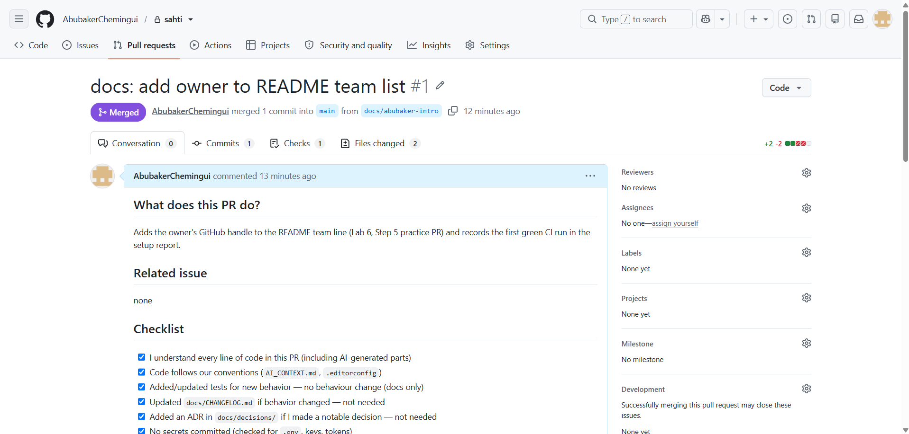
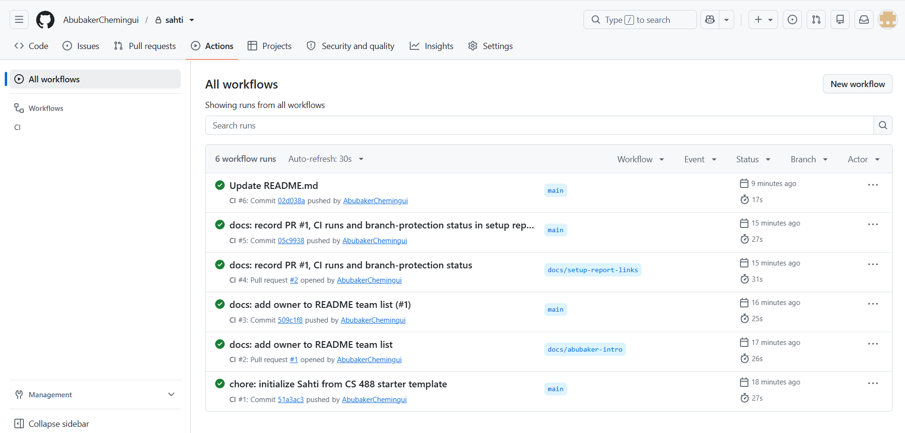

# Lab 6 — Setup Report

**Project:** Sahti (صحتك) · **Date:** 2026-11-03 · **Course:** CS 488 — AI-First Software Engineering

## 1. Repository and members

- **Repo URL:** https://github.com/AbubakerChemingui/sahti (private; first created as `sahti--`, renamed — GitHub redirects the old links)
- **Members:** Abubaker — GitHub [@AbubakerChemingui](https://github.com/AbubakerChemingui) — product owner and sole developer

**One-person adaptation.** The lab is written for teams of 2–4. Sahti has one member, so:
- **Collaborators:** none to add.
- **Branch protection:** planned rule for `main`: require a pull request and the **CI** status check, with **0 required approvals**, because GitHub does not let an author approve their own pull request. **Status:** GitHub refuses branch protection on a *private* repository of a free personal account (API answer: "Upgrade to GitHub Pro or make this repository public to enable this feature"). `TODO: enable it after getting GitHub Pro (free through the GitHub Student Developer Pack) or making the repo public.` Until then, the rule is followed by convention: changes go through a PR with a green CI check, as PRs #1 and #2 show. One exception so far: the README title was edited directly on GitHub (commit `02d038a`, CI also green), which protection would have prevented. Review is a self-review against the PR checklist, done after a break (as Lab 4 §6.3 allows for one-person projects).
- **"Every member merged a PR":** satisfied by the owner's own PR (§4).

## 2. Stack

Flutter (Android) app · **Python 3.12 + FastAPI** backend · SQLite (demo) / PostgreSQL (pilot) · pytest. Reason in one line: the AI models are trained and served in Python, so one server language keeps a solo, zero-budget project small. Full record: [ADR 0002](decisions/0002-backend-python-fastapi.md); design decisions: [ADR 0003](decisions/0003-design-phase-decisions.md).

## 3. What was set up

| Lab step | Done |
|---|---|
| 1. Repo from the starter template | ✅ pushed to https://github.com/AbubakerChemingui/sahti (`main`, first CI run green: [run 41714203765](https://github.com/AbubakerChemingui/sahti/actions/runs/41714203765)) |
| 2. Setup script, `.env` local and not tracked | ✅ `./scripts/setup.sh`; `.env` ignored by `.gitignore` (checked with `git status`) |
| 3. `AI_CONTEXT.md` | ✅ project summary, stack with versions, structure, conventions, **safety rules**, glossary |
| 4. Stack appendix + design | ✅ Python appendix applied (`requirements.txt`, pytest, `pytest.ini`); data/model/database files added to `.gitignore`; `stack-appendices/` deleted; `docs/architecture.md` with 4 Mermaid diagrams from the Lab 5 design; ADRs 0002 and 0003; full RE/SRS/SDD in `docs/reference/` |
| 5. Safe workflow | ✅ first PR opened, CI green, merged ([#1](https://github.com/AbubakerChemingui/sahti/pull/1)); ⚠️ branch protection blocked by the free plan for private repos (§1) |
| 6. Verify | ✅ clean-clone test passed (§5); screenshots in §4 |

## 4. Merged PR and CI run

- **PR:** [#1 — docs: add owner to README team list](https://github.com/AbubakerChemingui/sahti/pull/1) (branch `docs/abubaker-intro`), CI [green](https://github.com/AbubakerChemingui/sahti/actions/runs/41714396194), squash-merged into `main`
- **Screenshot of the merged PR:**

  
- **Screenshot of the green CI runs** (all 6 runs green, on PR branches and on `main`):

  

## 5. Verification (clean-clone test)

A fresh copy of the repository was set up by following only the README's "Getting started" steps:
- `pip install -r requirements.txt` → success;
- `pytest` → **4 passed**;
- `GET /api/v1/health` → `{"status": "ok", "activeDataVersion": null, "modelVersion": null}`.

On GitHub: the CI run on `main` passed ([run 41714203765](https://github.com/AbubakerChemingui/sahti/actions/runs/41714203765)): Python 3.12, dependencies installed, 4 tests passed, docs reminder ran.

## 6. AI assistants

**How they are configured.** `AI_CONTEXT.md` is the single source of truth. `CLAUDE.md`, `.github/copilot-instructions.md`, `.cursor/rules/project.mdc` and `.cursorrules` all point to it, so every assistant gets the same project summary, stack, folder layout, conventions and, most importantly for a medical app, the **safety rules** (AI never chooses medicines or doses; no calculated doses; danger notices can't be removed; no external AI services). `CLAUDE.md` adds the real install, run and test commands.

**Test of the context (Lab 6 Step 3).** Prompt given to Claude with this repository open:

> *"Based on this project's context, suggest the folder and file where I'd add the login feature, and what conventions to follow."*

Summary of the answer:
- **Where:** a new `backend/app/auth/` package, with `router.py` for `POST /api/v1/auth/login` (SRS API-02) and `/auth/register`, `/auth/refresh` (API-01, API-03), `service.py` for password checking and token creation, `schemas.py` for the request and response models, and tests in `backend/tests/test_auth.py`, named after the requirements (`test_fr01_…`).
- **Rules to follow:**
  - email + password;
  - 15-minute access token and 30-day rotating refresh token, stored hashed (SEC-01);
  - after 5 failed logins in 15 minutes, a 15-minute wait (SEC-02);
  - a login error must not reveal whether the email exists;
  - secrets only from `.env` (`SAHTI_JWT_SECRET`);
  - no email or password in logs (NFR-09);
  - `snake_case` in Python and `camelCase` JSON fields;
  - error codes from SRS §14 (`E-AUTH-003`);
  - tests first;
  - a `docs/CHANGELOG.md` line.

**Why this shows the context works.** A generic assistant would suggest a generic `src/login.py`. This answer used our folder layout, our SRS IDs, our token lifetimes, our error codes and our logging rule, all of which exist only in `AI_CONTEXT.md` and the documents it links.

## 7. Still TODO before implementation starts

- Generate the Flutter project in `mobile/` and add a Flutter job to CI.
- Add ruff (lint and format) to CI.
- Clinical data: no source or reviewer yet (OQ-01 – OQ-05). Build with DRAFT fixture data only.
- Text-reader bake-off (OQ-07) and training data.
- Licence: the template's MIT licence is kept for now. Reconsider before making the repo public, given the plan to turn Sahti into a product.
